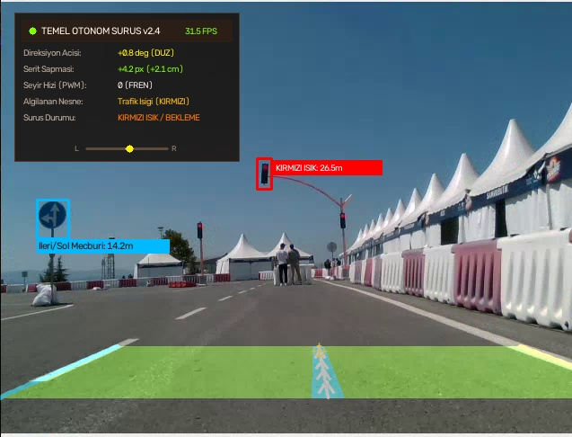
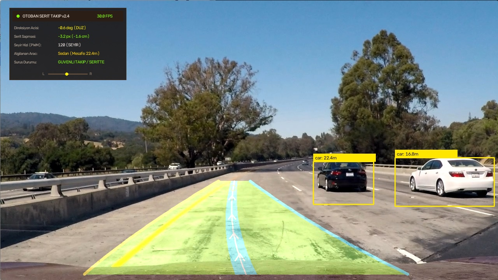
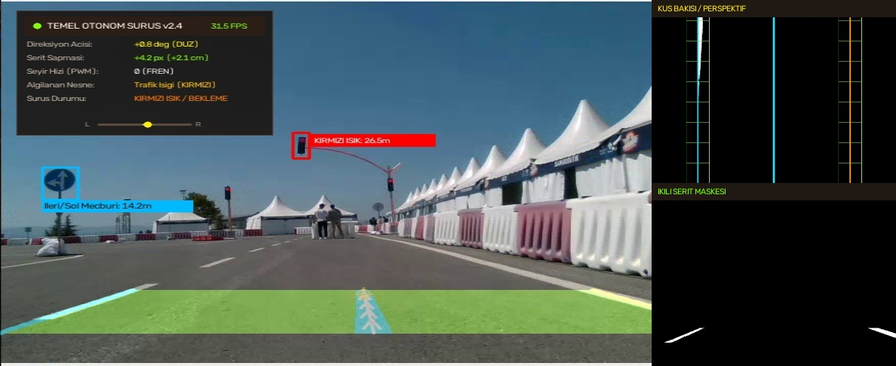
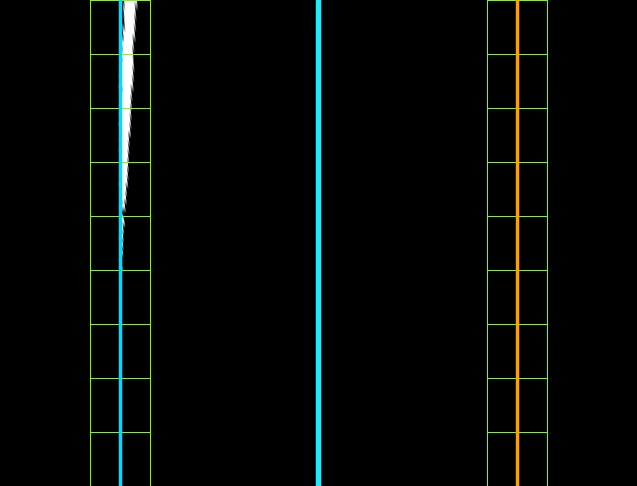

# Temel Otonom Sürüş ve Görüntü İşleme Sistemi

OpenCV, Ters Perspektif Eşleme (IPM), Hough Dönüşümü ve YOLOv8 tabanlı; gerçek zamanlı şerit takibi, yönlendirici araç gidiş yolu yörüngesi, anti-windup PID kontrollü direksiyon yönetimi ve derin öğrenmeli nesne/araç mesafe kestirimi altyapısı.

Bu proje; robotik kara araçları (UGV), Teknofest Robotaksi yarışma araçları ve model otonom araçlar için kamera görüntüsü üzerinden yol sınırlarını çıkarıp aracı şerit ortasında tutmak, yoldaki araç/engellere olan mesafeyi trigonometrik olarak hesaplamak, çift Arduino seri protokolü üzerinden motor ve servoları sürmek ve sürüş telemetrisini canlı bir Glassmorphism HUD arayüzünde sunmak amacıyla geliştirilmiştir.

---

## Ekran Görüntüleri ve Canlı Arayüz

| Teknofest Robotaksi Pisti (HUD & Trajektori) | Otoban Sürüşü & Araç Takibi (HUD) |
| :---: | :---: |
|  |  |

| Geliştirici Çoklu Görünüm Paneli | Kuş Bakışı (IPM & Kayan Pencere) |
| :---: | :---: |
|  |  |

---

## Adım Adım Mimari ve Evrim Süreci

Proje, geleneksel görüntü işlemeden başlayıp derin öğrenme ve donanım entegrasyonuna uzanan 4 kademeli bir evrim mimarisine sahiptir:

### 1. Aşama: Geleneksel Görüntü İşleme (Canny + Hough + Polinom)
* **Ön İşleme & Gölge Dayanımı:** HLS ve HSV renk uzayına dönüştürme, **CLAHE** (Contrast Limited Adaptive Histogram Equalization) ile sert gölgeli ve aşırı aydınlık zeminlerin normalizasyonu.
* **Bariyer Filtresi:** Teknofest ve pist testlerinde kenarlardaki kırmızı/turuncu plastik bariyerlerin şerit olarak algılanmasını önleyen doygunluk ve ton filtrelemesi.
* **İlgi Alanı (ROI):** Yol dışı unsurlar (gökyüzü, kaput, ağaçlar) dinamik yamuk poligon ile maskelenir.
* **Hough Çizgi Dönüşümü:** `HoughLinesP` ile kenar pikselleri çizgi vektörlerine dönüştürülür, eğimlerine göre ($\frac{\Delta y}{\Delta x}$) sol ve sağ şerit doğruları olarak gruplanır.
* **Şerit Koridoru & Araç Gidiş Yolu (Trajectory Ribbon):** Şerit sınırları arasına zümrüt yeşili saydam sürüş koridoru yerleştirilir; şeridin tam ortasına ise ileri yönlü navigasyon okları (`^`), neon trajektori bandı ve araç hedefleme odak noktası içeren parlak yörünge çizgisi çizilir.

### 2. Aşama: Kuş Bakışı Dönüşümü (IPM) & Kayan Pencere (Sliding Window)
* **Ters Perspektif Eşleme (IPM):** 4 noktalı homografi matrisi ile kamera açısı yukarıdan dik kuş bakışı açısına dönüştürülür (`cv2.warpPerspective`).
* **Histogram Tabanlı Kayan Pencereler:** Histogram piksel tepelerine göre dikeyde 10 pencere boyunca şerit pikselleri toplanır ve 2. derece parabolik eğri uydurulur:
  $$x = A \cdot y^2 + B \cdot y + C$$
* **Viraj Yarıçapı (Eğrilik):** Yol eğriliği pikselden metreye dönüştürülerek hesaplanır:
  $$R_{\text{curve}} = \frac{\left(1 + (2Ay + B)^2\right)^{3/2}}{|2A|}$$

### 3. Aşama: Derin Öğrenme / YOLOv8 ve Mesafe Kestirimi
* **Güneş - Gölge Problemi & YOLOv8 Şerit Segmentasyonu:** Geleneksel HSV renk filtreleri, yarışma parkurlarındaki ağaç ve çadır gölgelerinde ($V$ parlaklık kanalının ani düşmesi) şerit çizgilerini kaybeder veya güneş altındaki açık renkli asfaltı/bariyerleri şerit zannederek hataya düşer. Bu sorunu çözmek için eğitilen **YOLOv8 Şerit Segmentasyon Modeli (`modeller/yolov8_serit_seg.pt`)** ve [`core/yolo_serit.py`](file:///home/atom13/Projeler/Temel_Otonom/core/yolo_serit.py), renk eşikleri yerine derin konvolüsyonel öznitelikleri ve yol geometrisini baz alarak derin gölgeler altında dahi (`test_verileri/golge.webm`) kesintisiz şerit sürekliliği sağlar.
* **Nesne & Araç Tespiti:** YOLOv8 mimarisi ile öndeki araçlar (`car`, `truck`, `bus`) ve trafik işaretleri eş zamanlı taranır.
* **Pinhole Kamera Mesafe Kestirimi:** Bounding box piksel genişliği ($w_{px}$), kameranın odak uzaklığı ($f$) ve aracın gerçek dünyadaki ortalama genişliği ($W \approx 1.85\text{ m}$) kullanılarak araca olan gerçek mesafe hesaplanır:
  $$\text{Mesafe (m)} = \frac{W_{\text{gerçek}} \times f}{w_{\text{kutu}}}$$

### 4. Aşama: PID Kontrol & Donanım Haberleşmesi
* **Merkez Sapma:** Aracın kamera merkezi ile şerit merkezi arasındaki piksel farkı ($e$) hesaplanır.
* **Anti-Windup PID Direksiyon:** Doyum korumalı PID algoritması ile servo dönüş açısı ($-35^\circ$ ile $+35^\circ$ arası) üretilir:
  $$u(t) = K_p \cdot e(t) + K_i \int e(t)dt + K_d \cdot \frac{de(t)}{dt}$$
* **Akıllı Hız Kontrolü:** Öndeki araç takip mesafesi ($<8\text{ m}$) veya viraj keskinliğine göre motor PWM değeri dinamik olarak azaltılır; acil durumlarda araç güvenle durdurulur.
* **Çift Arduino Seri Protokolü:**
  1. *Standart ASCII Protokolü:* `H<hiz>A<aci>\n` (Örnek: `H110A-12.5\n`)
  2. *Kat4 Teknofest Robotaksi Protokolü:* `[f/r/l]<aci>v<hiz>\n` (Örnek: `r015v110\n`, `l020v095\n`, `f000v120\n`)

---

## Proje Dizin Yapısı

```text
Temel_Otonom/
├── core/
│   ├── __init__.py
│   ├── klasik_serit.py       # Faz 1: Canny + Hough + Polinom şerit tespiti
│   ├── serit_tespit.py       # Faz 2: IPM kuş bakışı & sliding window tespit modülü
│   ├── yolo_tespit.py        # Faz 3: YOLOv8 nesne, araç ve tabela tespiti
│   ├── yolo_serit.py         # Faz 3: YOLOv8 şerit segmentasyonu (Gölgeye dayanıklı şerit takibi)
│   ├── mesafe_hesaplayici.py # Bounding box boyutundan mesafe kestirim motoru
│   └── pid_surucu.py         # Faz 4: Anti-windup PID direksiyon ve akıllı hız regülatörü
├── donanim/
│   ├── __init__.py
│   ├── arduino_haberlesme.py # USB UART seri port iletişimi (Çift protokol & simülasyon destekli)
│   └── otonom_surucu.ino     # DC motor ve yön servosu için Arduino firmware
├── araclar/
│   ├── __init__.py
│   ├── cizici.py             # HUD telemetri paneli, şerit koridoru ve gidiş yolu çizici
│   ├── roi_secici.py         # Perspektif köşe noktalarını kalibre etme aracı
│   └── hsv_ayar.py           # Canlı trackbar'lar ile HSV filtre kalibrasyon aracı
├── modeller/
│   ├── best.pt               # YOLOv8 nesne, araç ve tabela tespit ağırlıkları
│   └── yolov8_serit_seg.pt   # YOLOv8 semantik şerit segmentasyon model ağırlıkları
├── yolo_serit_test.py        # Gölge parkurları için YOLOv8 şerit takip test scripti
├── test_verileri/
│   ├── otoban.mp4            # Otoyol şerit ve araç sürüş test kaydı
│   ├── golge.webm            # Gölge varyasyonlu pist sürüş kaydı
│   └── yeni.webm             # Viraj ve tabela pist sürüş kaydı
├── gorseller/
│   ├── hud_gorunumu.jpg      # Canlı HUD ve araç gidiş yolu ekran görüntüsü
│   ├── coklu_panel.jpg       # Geliştirici çoklu kamera / debug görünümü
│   ├── kus_bakisi.jpg        # Kuş bakışı perspektif çizimi
│   └── hsv_maske.jpg         # İkili şerit kenar maskesi
├── tests/
│   └── test_pipeline.py      # Kapsamlı birim ve entegrasyon test paketi
├── config.yaml               # Sistem parametreleri (PID, Kamera, YOLO, ROI)
├── main.py                   # Modüler ana çalıştırma giriş noktası
├── requirements.txt          # Python bağımlılıkları
└── README.md                 # Kapsamlı teknik dokümantasyon
```

---

## Kurulum ve Çalıştırma

### 1. Bağımlılıkların Yüklenmesi
```bash
python3 -m venv .venv
source .venv/bin/activate
pip install -r requirements.txt
```

### 2. Sistemi Çalıştırma
```bash
# Hibrit Mod (Klasik Şerit + YOLO Araç/Mesafe Takibi + HUD Trajektori)
python main.py --mod hibrit --video test_verileri/otoban.mp4

# Geliştirici / Debug Modu (Kuş Bakışı ve İkili Maske Paneli Dahil)
python main.py --mod hibrit --video test_verileri/otoban.mp4 --debug

# Saf Klasik Görüntü İşleme Modu (Canny + Hough)
python main.py --mod klasik --video test_verileri/otoban.mp4

# Kuş Bakışı Kayan Pencere Modu (IPM + 2. Derece Polinom)
python main.py --mod kus_bakisi --video test_verileri/golge.webm

# Canlı USB Kamera ile Çalıştırma
python main.py --kamera 0 --mod hibrit

# YOLOv8 Semantik Şerit Takibi Modu (Ağaç & Çadır Gölgelerine Dayanıklı)
python main.py --mod yolo_serit --video test_verileri/golge.webm

# Bağımsız YOLO Şerit Test Scripti
python yolo_serit_test.py --video test_verileri/golge.webm

# Arduino Donanım Bağlantısı ile Çalıştırma (Kat4 Protokolü)
python main.py --video test_verileri/otoban.mp4 --seri --protokol kat4_rv
```

### 3. Kalibrasyon Araçları
* **Perspektif ROI Kalibrasyonu:**
  ```bash
  python araclar/roi_secici.py --kaynak test_verileri/otoban.mp4
  ```
  *(Sırasıyla: Sol-Üst, Sol-Alt, Sağ-Üst, Sağ-Alt noktalarına tıklayın; `r` ile sıfırlayın).*

* **HSV Renk Eşik Kalibrasyonu:**
  ```bash
  python araclar/hsv_ayar.py --kaynak test_verileri/otoban.mp4
  ```

---

## Donanım Bağlantı Şeması ve Seri Protokol

### Arduino Pin Atamaları
| Donanım | Arduino Pini | Sinyal Tipi | Açıklama |
| :--- | :--- | :--- | :--- |
| **Yön Servosu** | Pin 9 | PWM (Servo) | 55° (Sol) - 90° (Merkez) - 125° (Sağ) |
| **DC Motor Hızı** | Pin 5 | PWM | 0 - 255 PWM Sürüş Hızı |
| **DC Motor Yönü** | Pin 6 | Dijital OUT | HIGH = İleri, LOW = Geri / Fren |

### Seri Protokol Formatları
1. **ASCII Protokolü (`ascii_ha`):**
   ```text
   H<hiz>A<aci>\n
   Örnek: H110A-14.5\n  -> Hız 110 PWM, Direksiyon -14.5 derece (Sola)
   ```
2. **Kat4 Robotaksi Protokolü (`kat4_rv`):**
   ```text
   [f/r/l]<aci_3_basamak>v<hiz_3_basamak>\n
   Örnek: r015v110\n    -> Sağa 15 derece, Hız 110 PWM
   Örnek: l020v095\n    -> Sola 20 derece, Hız 95 PWM
   Örnek: f000v120\n    -> Düz gidiş, Hız 120 PWM
   ```

---

## Birim ve Entegrasyon Testleri

Tüm algoritmaların, sınır durumlarının (boş kare, aşırı ışık, geçersiz kutu, vb.) ve video akışlarının otomatik doğrulanması için test paketini çalıştırın:

```bash
python -m unittest tests/test_pipeline.py -v
```

---

## Lisans ve Yazar

- **Geliştirici:** aToom13 (<200818akif@gmail.com>)
- **Lisans:** MIT Lisansı

